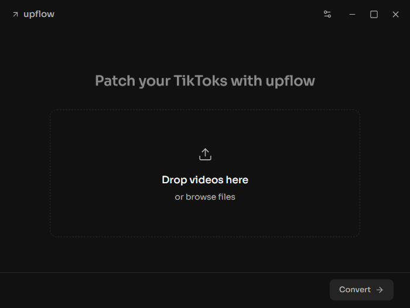

# upflow

upflow is a portable Windows 11 app for getting videos ready to upload to TikTok. Drop in a clip or a batch and it exports MP4s locally on your PC.

<p align="center">
  
</p>

## Getting started

1. Extract the portable ZIP and open `Upflow.exe`.
2. Drag your videos into upflow or browse for them, then click **Convert**.
3. Find your exports next to the originals, or choose a different folder in **Settings**. A file called `clip.mp4` becomes `clip_upflow.mp4`.

Change the video bitrate or GPU settings under **Settings → Encoder**. upflow can resize matching clips together and shows progress in the Windows taskbar.

See [how upflow patches videos](docs/PATCHING.md) or read the [v1.1.0 changelog](CHANGELOG.md).

## Build from source

Install [Rust](https://rustup.rs/) with the MSVC toolchain, [Node.js](https://nodejs.org/) 22.12 or newer, [MSYS2](https://www.msys2.org/), and [Visual Studio Build Tools](https://visualstudio.microsoft.com/downloads/) with **Desktop development with C++** and a Windows SDK.

From the project folder in **MSYS2 UCRT64**, build the media tools. Rebuild these if you’re upgrading from a build without GPU support.

```bash
pacman -S --needed git make tar gzip mingw-w64-ucrt-x86_64-gcc mingw-w64-ucrt-x86_64-nasm mingw-w64-ucrt-x86_64-pkgconf
bash scripts/build-media-tools.sh
```

Then switch to **PowerShell** in the same project folder.

```powershell
rustup default stable-x86_64-pc-windows-msvc
.\scripts\package-windows.ps1
```

The portable ZIP lands in `release\`. See the [media tools notice](licenses/MEDIA-TOOLS.md) for the bundled FFmpeg and x264 sources and licenses.
